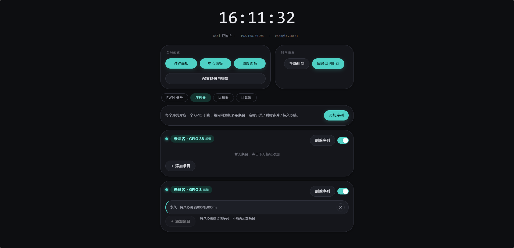
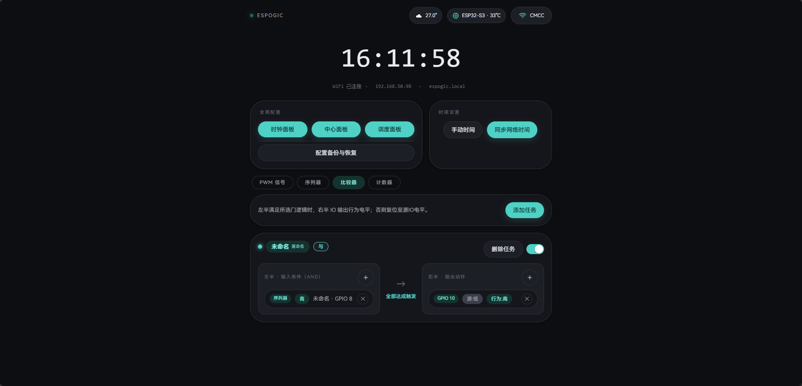
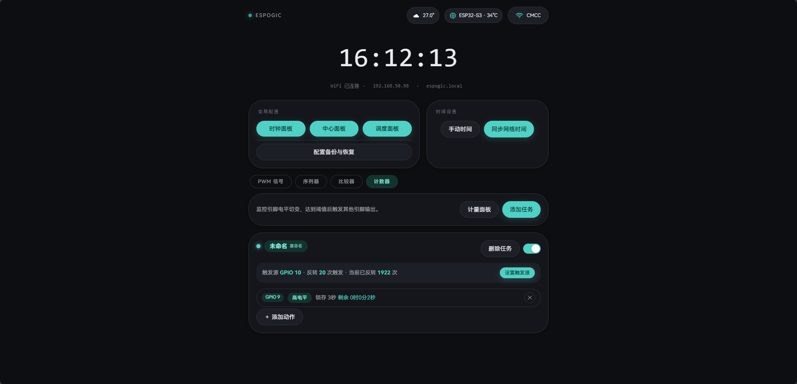
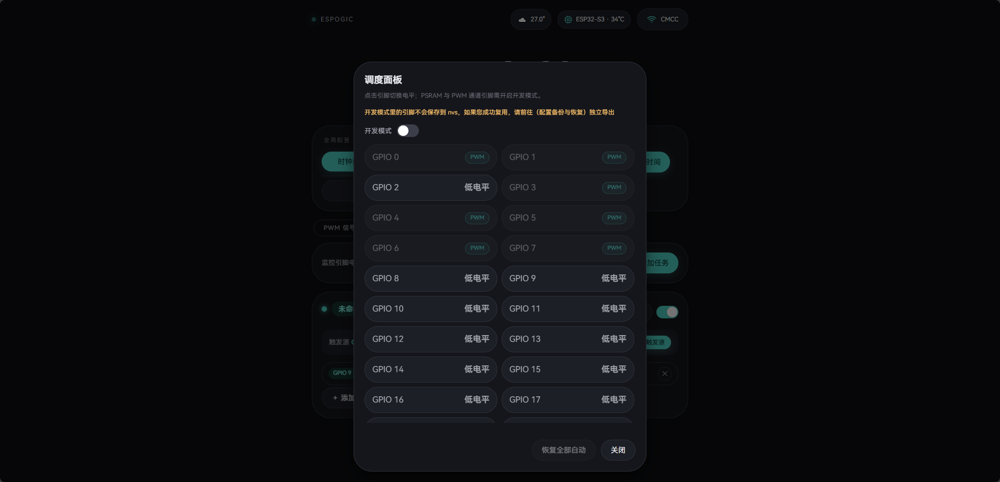
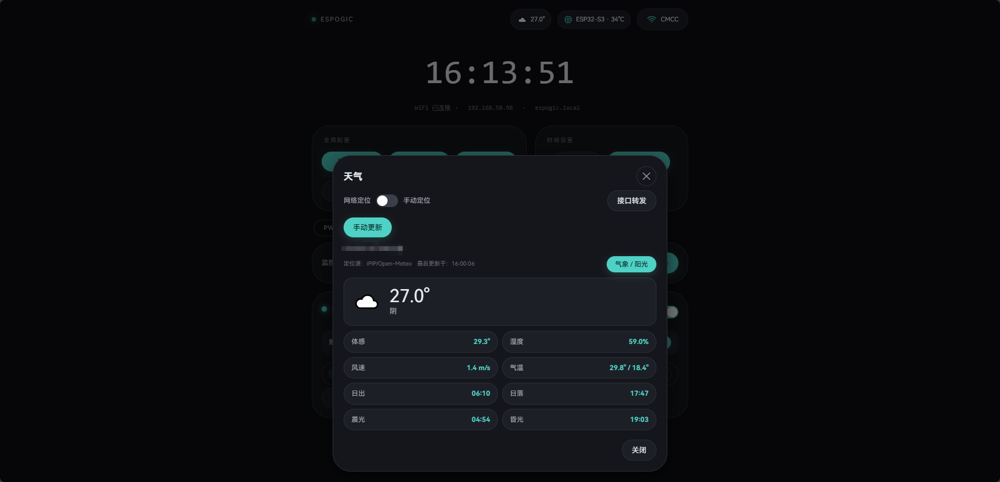

# ESP32-S3 信号调度模块（espogic）

把 ESP32-S3 当作**可编程信号源 / 时序控制器**用的一套固件：PWM、序列器、比较器、计数器、阳光与天气联动、时间同步，全部在设备自带网页上配置，配置持久化到 NVS，重启即恢复。

主循环为**全非阻塞**设计——NTP、WiFi、天气抓取都是逐步推进的状态机或独立 FreeRTOS 任务，HTTP 服务也跑在独立任务上，因此浏览器刷新、卡死或中断都不会冻结控制逻辑。

---

## 主要能力

### 输出与逻辑

| 模块 | 说明 |
| --- | --- |
| **PWM** | LEDC 驱动，最多 8 通道；每通道最多 6 条时间条目。条目为「起止时刻 + 起止占空比」线性插值，支持跨日；同通道内时间窗口重叠（左闭右开）会标记冲突并跳过 |
| **时钟** | 硬件 timer 的抽象，固定 4 个（对应 LEDC timer0~3）。频率全局唯一，范围 1 Hz ~ 40 kHz，占空比分辨率按时钟频率自适应（最高 14 位）；被条目引用时不可删除 |
| **序列器** | 最多 20 组，每组 1 个 GPIO + 最多 20 条条目。三种模式：定时开关（到点保持电平）、瞬时脉冲（拉高/拉低 N 毫秒后回到基础电平）、持久心跳（无时间维度、永久循环，在序列内独占） |
| **比较器** | 最多 10 个门。左半最多 8 个输入条件，门逻辑支持 AND / OR / NOR / NAND，输入来源可为序列器组、计数器动作或外部输入引脚；右半最多 8 个输出动作（源 IO 电平 / 行为电平） |
| **计数器** | 最多 10 个任务，每个任务 = 1 个触发源引脚 + 阈值 X + 最多 10 个输出动作。触发源电平每反转一次计 1 次，达到阈值即触发动作；动作保持模式支持「一直保持」与「延时关闭」（最长 168 小时）。另带全局电平切变计量面板 |
| **手动覆盖 / 锁存** | 手动 = 改写该引脚的「基准电平」，脉冲、心跳、定时开关、比较器、计数器输出均可覆盖它；锁存 = 绝对锁，任何模块都改不动，只能在面板上手动解除 |

### 与环境联动

- **阳光交互**：以当日太阳时刻为曲线端点（可选「日出 → 日落」或「晨光 → 昏光」），生成 `0% → 峰值 → 0%` 的三角曲线，替代条目插值。
- **天气交互**：按 WMO 天气码映射占空比系数（晴 100% 起逐级递减），通道开启后输出 = 原始占空比 × 天气系数；天气档位切换时系数在设定时长内匀速过渡（默认 25 分钟，上限 50 分钟），避免占空比瞬间跳变。
- **太阳时刻**：日出/日落取自 Open-Meteo 的每日预报，晨光/昏光由本地 NOAA 算法计算（太阳高度角 -18° 的天文晨昏蒙影），纯本地、不联网。
- **定位**：自动模式优先 IP 定位（国内优先，判定为国外则回退全球经纬度服务），再走地理编码与天气查询；手动模式按省 / 市 / 区选择。定位结果同时用于刷新时区。
- **接口转发**：可配置 Cloudflare Worker 等中转地址作为天气抓取的第三级兜底，示例见 [`bag/CF转发例程.js`](bag/CF转发例程.js)。

### 时间

- **非阻塞 NTP**：自实现 UDP 客户端，每次 `loop()` 只推进一步（发送 → 非阻塞等待 → 超时切换）；主服务器 + 3 台备用服务器；支持每日自动校准与前端手动同步。
- **时区**：自动（网络定位）与手动（UTC±X）两种模式，一律采用「冬令时」基准，不随夏令时跳变。时区偏移在设备侧动态生效，所有时间显示与调度都以它为基准。
- **启动编排**：定位（求时区）→ NTP（拿 UTC）→ 天气，确保定位结果先到手，NTP 落地后直接显示正确本地时间。

### 网络

- STA 模式自动重连，多次失败后自动切换为 AP 热点兜底。
- AP 模式带 DNS 劫持（captive portal），任意域名解析到热点网关地址。
- mDNS 访问：`http://espogic.local`。
- 可强制使用公共 DNS，规避路由器转发丢弃 ECS 导致 CDN 返回不可达节点的问题。

### 配置与诊断

- 配置存于 NVS（Preferences），采用防抖落盘；写失败会在前端显示常驻横幅提示。
- 全量可读 JSON 的导入 / 导出（WiFi 凭据不随导出文件传输）。
- 环形缓冲日志：同时输出到串口与网页回看。
- 中心面板：只读监控全部在用引脚 + 电平反转归因（模块 → 组 → 条目三级）。
- HTTP 服务运行在独立任务（核心 0 / 优先级 1 / 栈 10 KB），状态修改受递归状态锁保护，且「锁内不发送响应」。
- 主循环负载与卡顿统计（迭代率、> 50 ms 卡顿计数）。
- 芯片型号自动识别 + 手动固定，内置多型号的 Flash / PSRAM 禁用引脚表。

---

## 运行环境

**目标硬件**：ESP32-S3（N16R8，16 MB Flash + 8 MB PSRAM）。其它型号通过禁用引脚表兼容，但未做完整适配验证。

**Arduino IDE 板卡配置**（工具 → 开发板 → ESP32S3 Dev Module）：

| 选项 | 值 |
| --- | --- |
| Flash Size | 16 MB |
| PSRAM | OPI PSRAM (8 MB) |
| USB CDC On Boot | Enabled |
| Partition Scheme | 16M Flash (3 MB APP / 9.9 MB FATFS) 或 Huge APP |
| USB Mode | Hardware CDC and JTAG |

> 工程未附带自定义分区表，直接使用内核预置的上述方案。

**依赖库**：ArduinoJson（第三方，需自行安装）。其余（WebServer、WiFi、WiFiUdp、ESPmDNS、DNSServer、Preferences、freertos、`driver/ledc`、`driver/gpio`）由 ESP32 Arduino 内核提供。工程直接使用 ESP-IDF 底层 LEDC / GPIO 驱动，建议使用较新的 ESP32 Arduino 内核（3.x）。

---

## 目录结构

```
espogic/
├─ espogic.ino      # 主草图：全局变量、WiFi 连接与重连、启动流程、主循环、负载统计
├─ config.h               # 集中配置与所有模块的对外声明
├─ pin_bus_map.h          # 各芯片 Flash / PSRAM 禁用引脚表（全局唯一维护点）
├─ config_store.ino       # NVS 配置存储、跨任务状态锁、配置导入 / 导出、恢复出厂
├─ pwm_manager.ino        # LEDC PWM：通道 / 时钟 / 条目、引脚释放与恢复
├─ Timer.ino              # 序列器（定时开关 / 瞬时脉冲 / 持久心跳）
├─ time_manager.ino       # 非阻塞 NTP 状态机与时区换算
├─ solar.ino              # 太阳位置算法（日出 / 日落 / 天文晨昏光）
├─ sun_interact.ino       # 阳光交互曲线
├─ weather.ino            # 天气抓取：定位 → 地理编码 → 天气查询，含过渡与状态缓存
├─ central.ino            # 中心面板：只读监控与电平反转归因
├─ counter.ino            # 计数器
├─ digital_comparator.ino # 比较器
├─ logger.ino             # 环形缓冲日志
├─ web_server.ino         # HTTP 路由、独立 HTTP 任务、各接口处理函数
├─ webpage.h              # 网页静态资源总入口
├─ web/                   # 网页 CSS / HTML / JS 分片
├─ images/                # README 界面预览截图
└─ bag/                   # 附属示例（Cloudflare Worker 转发例程）
```

---

## 快速开始

1. 按上表设置 Arduino IDE 板卡选项，安装 ArduinoJson，编译并烧录 `espogic.ino`。
2. 首次上电若没有已保存的 WiFi 凭据，设备会进入**热点模式**：
   - SSID：`Espogic`
   - 密码：`12345678`
   - 访问地址：`http://192.168.4.1`
3. 在网页「WiFi」页扫描并保存家庭 WiFi 凭据，重启后设备会自动连接。
4. STA 模式下访问 `http://espogic.local`，或串口日志中打印的 IP 地址。
5. 开始添加 PWM 通道、序列、比较器、计数器，或在「天气」页配置定位与天气交互。

> 热点 SSID/密码是硬编码的默认值，正式使用请修改 `espogic.ino` 中的 `AP_SSID` / `AP_PASSWORD`。

---

## 引脚规则（务必了解）

- **写者互斥**：PWM 输出、序列器输出、比较器输出、计数器动作属于「全局唯一写者」，两两互斥，同一引脚同一时刻只能由一个模块驱动。
- **读可共享**：计数器触发源与比较器外部输入是只读输入，可与其他读者共享，但不得与任何写者重叠。
- **电平优先级**：锁存 > 脉冲 / 心跳 > 手动基准 / 调度基础 > 实际读值。
- **禁用引脚**：Flash / PSRAM 总线引脚全局禁用（见 [`pin_bus_map.h`](pin_bus_map.h)），用作普通输出会立即崩溃。
- **S3 需避开**：GPIO19/20（原生 USB D-/D+）、GPIO26~37（Flash / OPI PSRAM）、GPIO43/44（UART0）、GPIO0/3/45/46（Strapping）。
- 默认 6 路 PWM 引脚为 GPIO14 / 15 / 16 / 17 / 18 / 21，出厂通道数为 0，由用户自行添加。

---

## 网页界面

- **首页**：芯片信息、WiFi / 网络状态、时间设置（手动时间、同步网络时间）。
- **序列器 / 比较器 / 计数器**：三个主功能分区。
- **天气**：网络定位、手动定位、接口转发、气象 / 阳光交互配置。
- **全局入口**：时钟面板、中心面板、调度面板、配置备份与恢复。

## 界面预览

采用深色 Material You 风格，顶部是实时时钟与网络状态栏（WiFi 状态 · IP · mDNS 地址），下方依次为全局配置、时间设置与四个功能分区。













---

## HTTP 接口

> 除根路径 `/` 外，所有接口都经状态锁包装；`GET` 用于读取，`POST` 用于写入。

**状态与时间**

```
GET  /                 网页首页
GET  /getconfig        读取 PWM / 时钟等通道配置
GET  /getstatus        运行状态与保存失败汇总
GET  /gettime          当前时间
GET  /getchannelstatus 各通道实时占空比
GET  /getntpsyncstatus 手动 NTP 同步状态
POST /settime          手动设置时间
GET  /syncntptime      触发一次同步网络时间
GET  /chipinfo         芯片信息
POST /chipset          手动固定芯片型号
POST /chipclear        清除固定，恢复自动识别
GET  /getlogs          拉取环形日志
```

**WiFi**

```
GET  /wifiscan         扫描周边 WiFi
POST /wifisave         保存 WiFi 凭据
```

**PWM / 时钟**

```
POST /togglechannel         启用 / 停用某通道
POST /savechannel           保存某通道基础配置
POST /savepins              保存 PWM 引脚映射
POST /pwmadd                新增 PWM 通道
POST /pwmdel                删除 PWM 通道
POST /pwmtaskadd            新增 PWM 条目
POST /pwmtaskdel            删除 PWM 条目
POST /pwmweathertoggle      切换通道的天气交互
POST /pwmsun                设置通道的阳光交互
POST /pwmfadecomplete       立即完成天气系数过渡
GET  /clockget              读取时钟列表
POST /clockadd              新增时钟
POST /clockremove           删除时钟
POST /clocksetfreq          修改时钟频率
```

**序列器**

```
GET  /iogetconfig       读取全部序列配置
POST /iogroupadd        新增序列
POST /iogroupdel        删除序列
POST /iogroupupdate     编辑序列
POST /iotoggle          启用 / 停用序列
POST /ioentryadd        新增条目
POST /ioentrydel        删除条目
POST /ioentryupdate     编辑条目
GET  /iostatus          序列实时状态
POST /iosetlevel        手动设定引脚基准电平
POST /ioautoreset       自动重置（全部或单引脚）
POST /latchset          锁存引脚
POST /latchclear        解除锁存
```

**比较器**

```
GET  /comparatorgetconfig      读取全部比较器配置
POST /comparatorgateadd        新增门
POST /comparatorgatedel        删除门
POST /comparatorgateupdate     编辑门
POST /comparatorgatemode       设置门逻辑类型
POST /comparatortoggle         启用 / 停用门
POST /comparatorinputadd       新增输入条件
POST /comparatorinputdel       删除输入条件
POST /comparatoroutputadd      新增输出动作
POST /comparatoroutputdel      删除输出动作
```

**计数器**

```
GET  /countergetconfig     读取全部计数器配置
GET  /counterstatus        实时计数状态
POST /counterclear         清零全部计数
POST /counterclearpin      清零单个引脚计数
POST /counterdevmode       开发模式开关（统计 PWM / Flash 引脚切变）
POST /countertaskadd       新增任务
POST /countertaskdel       删除任务
POST /countertaskupdate    编辑任务
POST /countertoggle        启用 / 停用任务
POST /countertriggerset    设置触发源与阈值
POST /counteractionadd     新增动作
POST /counteractiondel     删除动作
POST /counteractionupdate  编辑动作
```

**中心面板**

```
GET  /centralstatus    引脚集合与边沿事件
GET  /centraldetail    某引脚的触发归因
```

**天气 / 时区**

```
GET  /weatherget        读取天气定位配置
POST /weathersave       保存天气定位配置
GET  /weatherstatus     天气与位置实时状态
GET  /relayget          读取接口转发地址
POST /relaysave         保存接口转发地址
POST /relaytest         测试接口转发连通性
GET  /relayteststatus   转发测试结果轮询
GET  /gettz             读取时区配置
POST /savetz            保存时区配置
GET  /wxfadeget         读取天气系数过渡时长
POST /wxfadesave        保存天气系数过渡时长
```

**配置备份 / 恢复**

```
GET  /exportconfig     导出全量配置（可读 JSON）
POST /importconfig     导入全量配置
GET  /nvsdata          查看 NVS 已保存数据
GET  /nvsstats         NVS 容量统计
POST /factoryreset     恢复出厂（含 WiFi）
POST /resetconfig      重置配置（保留 WiFi）
```

---

## 数据来源与致谢

定位与天气均依赖第三方公共服务，本项目只做调用与展示。部署到自己的设备前，请自行确认各服务的使用条款与免费配额。

| 用途 | 服务 |
| --- | --- |
| IP 定位 | iPIP.net / ipwho.is |
| 地理编码（城市名 → 经纬度） | Open-Meteo Geocoding API |
| 天气预报与日出日落 | Open-Meteo Weather API |
| NTP 对时 | 阿里云 / 腾讯 / NTP Pool |

- **Open-Meteo**：免费接口按其上游授权（CC BY 4.0）使用，署名要求在此保留。天气现象采用 WMO 天气码，映射表在本地实现。
- **iPIP.net / ipwho.is**：免费 IP 地理定位接口。本项目按其返回的位置字段做国内 / 国外分流，不涉及商业依赖。
- **太阳位置**：晨光 / 昏光由本地 NOAA 算法计算，纯本地、不联网。
- **接口转发**：可自建 Cloudflare Worker 作为天气抓取的第三级兜底，示例见 [`bag/CF转发例程.js`](bag/CF转发例程.js)。

---

## 设计要点

- **全非阻塞**：NTP 与非阻塞 UDP 状态机、WiFi 非阻塞连接与重连、天气抓取在独立任务中执行，主循环只做标志位判断。`loop()` 定期喂狗。
- **网络串行化**：ESP32 Arduino 网络库不支持多任务并发访问，故用网络互斥锁串行化「天气抓取任务」与「主循环 NTP UDP」，避免 LwIP 断言崩溃。
- **状态锁**：HTTP 独立任务与主循环并发访问同一批配置结构，递归状态锁保证「读到的数组下标仍然有效」，且发送响应前必定解锁。
- **NVS 而非 EEPROM**：小块增量写入 + 磨损均衡，临界区远短于 EEPROM 整块擦写，规避随机看门狗复位。
- **占空比不闪空**：天气刷新期间保留旧天气状态，避免非晴天时占空比短暂跳到 100%。

---

## 许可证

本项目采用 [MIT 许可证](LICENSE)。

---

*本介绍由 AI 总结，如有不妥请指明。*

项目源地址（GitHub）：https://github.com/illusor-y/espogic
